  <table style="border: none; border-collapse: collapse;">
    <tr>
      <td style="border: none;">
        
      </td>
      <td style="border: none;">
        
      </td>
    </tr>
  </table>

                         .**#######%%#-                         email = alvesschann@gmail.com ---------------------------------
                      -%*****+**++=-:-:-=-                      name = SchannAlves --------------------------------------------
                    -#+--:....:=*+====-:.-=.                    motto = "Man errs as long as he strives" ----------------------
                   +=-......:=++++++++**=:..                    hobby = ["gaming", "collecting (figurine)", "reading"] --------
                  .+:.....--------=:-=-===-=                    techStack = [ -------------------------------------------------
                  :-::--:----:-:-=*#=======+                        [java, python, php, javascript, typescript], // languages -
                   .---==++++++++*++++***%*+                        [react, next.js, html5, css3, tailwind], // frontend ------
                    ======++++++-------+++++.                       [laravel, node.js], // backend ----------------------------
                     +========+++=-----====-                        [MySQL, PostgreSQL, SQLite], // database ------------------
                       -=======---==------=:                        [git, vscode, figma] // tools -----------------------------
                       :-===------===-----                      ] -------------------------------------------------------------
                 .*++-:.:----::-------:.:=+++*=.                focusArea = ["web development", "data analyst"] ---------------
           .+****++=-:...-------:::::.  .:-=+*######+.          
        ++*****+++=-:....-----------:. ...::=+***#######-
     .++++++++++=+-::.....----====--: .....::=++*****#***#+
    -==+==+=+++==-......:..:=++++==.. ..  ...:+++*****+*****
    ====-+-+==+===-::.....--..-+++=.... .....:-=+++++*++=++*+
    =-------=-==-=--::......-=...+-..........::--=====++--=*+:
    -::::::::::-:--:::........-=...............::-----==-:-+::-
    :::.....:. ...::::..........=+:..............::::::-.::..:::

<picture>
  <source media="(prefers-color-scheme: dark)" srcset="https://raw.githubusercontent.com/MonoArchon/MonoArchon/output/pacman-contribution-graph-dark.svg">
  <source media="(prefers-color-scheme: light)" srcset="https://raw.githubusercontent.com/MonoArchon/MonoArchon/output/pacman-contribution-graph.svg">
  
</picture>
